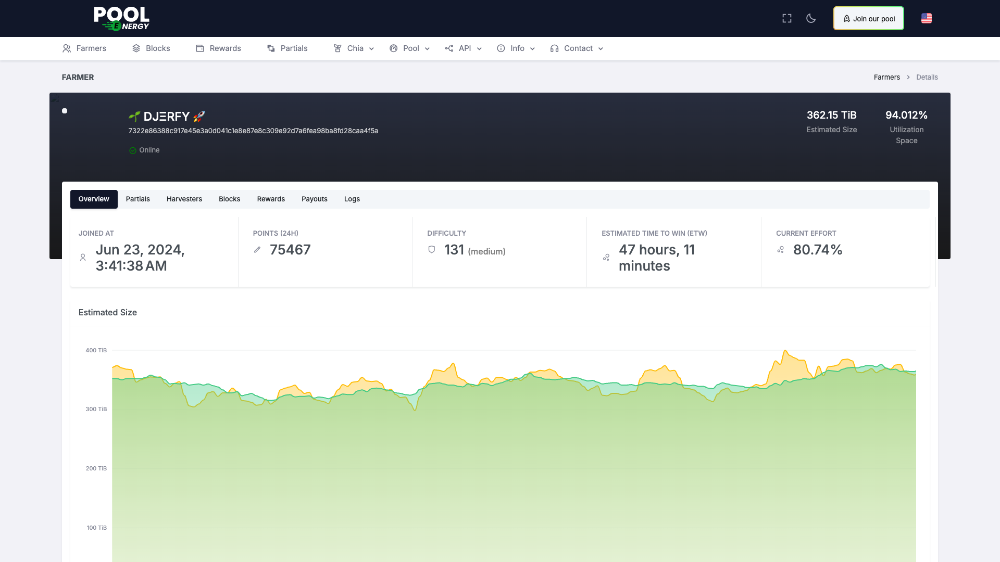

# Pool.Energy — Web

[](https://github.com/Pool-Energy/web/actions/workflows/build-and-publish.yml)
[](https://angular.dev)
[](https://nodejs.org)
[](LICENSE)

<picture>
  <source media="(prefers-color-scheme: dark)" srcset="docs/screenshot-dark.png">
  <source media="(prefers-color-scheme: light)" srcset="docs/screenshot-light.png">
  
</picture>

The web dashboard for **Pool.Energy**, a Chia farming pool. It gives farmers and
visitors a live view of the pool: space and member count, leaderboard, blocks,
rewards and payouts, partials, Chia blockchain state, pool logs, and the public
API documentation — all updated over WebSockets.

The application is a classic (NgModule-based) Angular SPA. It talks to the
Pool.Energy REST/WebSocket API and is shipped as a static bundle served by Caddy
inside a Docker image.

---

## Table of contents

- [Tech stack](#tech-stack)
- [Features](#features)
- [Getting started](#getting-started)
- [Available scripts](#available-scripts)
- [Project structure](#project-structure)
- [Architecture](#architecture)
- [Configuration](#configuration)
- [Testing](#testing)
- [Docker image](#docker-image)
- [Continuous integration](#continuous-integration)
- [Troubleshooting](#troubleshooting)
- [License](#license)

## Tech stack

| Concern             | Choice                                                                 |
| ------------------- | ---------------------------------------------------------------------- |
| Framework           | Angular 22 (NgModules, `standalone: false` components)                 |
| Language            | TypeScript 6.0 (`strict`, `strictTemplates`)                           |
| UI                  | Bootstrap 5.3 + `@ng-bootstrap/ng-bootstrap` 21 + custom SCSS theme    |
| Charts              | ApexCharts 8 via `ng-apexcharts`                                       |
| Terminal            | `ng-terminal` (+ `@xterm/xterm`) for the live pool log                 |
| i18n                | `@ngx-translate/core` 18 (standalone, provider-based API)              |
| Reactive            | RxJS 7.8, `zone.js` 0.16                                               |
| Unit tests          | Vitest 5 through the Angular CLI (`ng test`)                           |
| E2E tests           | Playwright against the production Docker image                         |
| Build               | `@angular/build` (esbuild) + `gzipper` (gzip/brotli pre-compression)   |
| Runtime             | Node.js 26 during build, Caddy 2.11 Alpine at runtime                  |
| License             | AGPL-3.0                                                               |

## Features

- **Live farmers dashboard** (`/farmers`, also `/`): pool space, active/total
  farmers, effort, estimate to win, current fee and XCH price, a top-3
  leaderboard and a paginated, searchable farmers table.
- **Farmer detail** (`/farmer/:id`): per-launcher stats, estimated size,
  difficulty history, partials, payouts and harvester list with charts.
- **Blocks** (`/blocks`): farmed blocks with pool space, proof and timeline.
- **Rewards** (`/rewards`, `/reward/:id`): payouts, payout addresses and payout
  transactions, with charts and CSV export.
- **Partials** (`/partials`): live partial submissions and per-launcher chart.
- **Chia** (`/chia`): blockchain state, consensus/fork tracking, netspace,
  mempool and XCH price.
- **Pool** (`/pool/status`, `/pool/stats`, `/pool/logs`): pool health, historical
  pool size and a live log stream rendered in an in-browser terminal.
- **Info pages** (`/info/faq`, `/info/fee`, `/info/team`) and **Join**
  (`/join`) instructions for new farmers.
- **Login** (`/login`, `/settings`): launcher-owner login and settings form.
- **7 languages**: English, French, German, Spanish, Dutch, Turkish, Chinese,
  selected from the browser or the topbar and persisted in a cookie.

## Getting started

### Requirements

- **Node.js** `^22.22.3 || ^24.15.0 || >=26.0.0` (constraint from Angular 22;
  the Docker image pins `node:26.12.1`)
- **npm** 11 (or any npm ≥ 8 supported by Angular)
- Optional: Docker for the container and E2E workflow

### Install

```bash
npm ci          # reproducible install from package-lock.json
```

### Development server

```bash
npm start       # https://localhost:4200 (production configuration, self-signed TLS)
npm run start:dev   # https://localhost:4200 (development configuration)
```

Both dev configurations use `src/proxy.conf.json`, which forwards `/api`,
`/static` and `/_proxy_ws` (WebSocket) to `https://pool.energy`. **A network
connection to the upstream API is required** for the pages to display data.

### Production build

```bash
npm run build
```

This runs `ng build --configuration=production` and then `gzipper` to generate
`.gz`/`.br` variants next to the bundles. Output: `dist/poolenergy/browser`.

## Available scripts

| Script              | What it does                                                          |
| ------------------- | --------------------------------------------------------------------- |
| `npm start`         | `ng serve --ssl --configuration=production` (https://localhost:4200)  |
| `npm run start:dev` | `ng serve --ssl --configuration=development`                          |
| `npm run build`     | Production build + gzip/brotli pre-compression                        |
| `npm test`          | Unit tests in watch mode (Vitest via `ng test`)                       |
| `npm run test:e2e`  | Build the Docker image, run it, then execute the Playwright suite     |
| `npm run watch`     | Development build in watch mode                                       |
| `npm run install:clean` | Remove `node_modules`/`package-lock.json`, reinstall and serve     |
| `npm run lint`      | Not configured — the project has no ESLint target                     |

## Project structure

```
web/
├── .github/workflows/          # Build & publish workflow (GHCR image)
├── docker/
│   ├── caddy/Caddyfile         # SPA fallback + /api and /ws reverse proxy
│   └── entrypoint.sh           # Renders the Caddyfile from env vars
├── docs/
│   ├── screenshot-light.png    # README screenshot (light theme)
│   └── screenshot-dark.png     # README screenshot (dark theme)
├── e2e/                        # Playwright smoke suite (separate package)
│   ├── playwright.config.ts
│   └── tests/smoke.spec.ts
├── scripts/e2e-docker.sh       # Build image → run container → run Playwright
├── src/
│   ├── app/
│   │   ├── core/
│   │   │   ├── interceptors/cd-kick.interceptor.ts
│   │   │   └── services/{language,pagination}.service.ts
│   │   ├── layouts/            # Shell: layout, topbar, footer, horizontal menu
│   │   ├── pages/              # 15 lazy-loaded feature pages + routing
│   │   ├── shared/             # SharedModule, breadcrumbs, chart helpers
│   │   ├── app.component.ts    # Root component
│   │   ├── app.module.ts       # Root module (providers, translate loader)
│   │   ├── app.routing.ts      # Lazy-loads PagesModule behind the layout
│   │   └── data.service.ts     # REST + WebSocket API client
│   ├── assets/
│   │   ├── i18n/               # de, en, es, fr, nl, tr, zh JSON dictionaries
│   │   ├── images/, fonts/, scss/
│   ├── environments/           # environment.ts / environment.prod.ts
│   ├── index.html
│   ├── main.ts                 # platformBrowserDynamic().bootstrapModule()
│   ├── proxy.conf.json         # Dev-server proxy to pool.energy
│   ├── styles.scss             # Global overrides (sticky footer, theme fixes)
│   └── test-setup.ts
├── angular.json
├── Dockerfile                  # Multi-stage: Node build → Caddy runtime
├── package.json
├── tsconfig.json               # strict + strictTemplates
├── vitest-base.config.mts      # Vitest tweaks (CJS deps of ng-terminal)
└── README.md
```

## Architecture

### Bootstrap and modules

- `src/main.ts` calls
  `platformBrowserDynamic().bootstrapModule(AppModule, { applicationProviders: [provideZoneChangeDetection({ eventCoalescing: true })] })`.
- `AppModule` wires the shell and the global providers:
  - `BrowserModule`, `AppRoutingModule`, `HttpClientModule`
  - `SharedModule`, `LayoutsModule`
  - `provideTranslateService({ fallbackLang: 'en', loader: provideTranslateHttpLoader({ prefix: 'assets/i18n/', suffix: '.json' }) })`
  - `CdKickInterceptor` as an `HTTP_INTERCEPTORS` entry (see the
    [change detection note](#angular-22-change-detection-workaround))
- `AppRoutingModule` declares a single route: the `LayoutComponent` shell with
  `loadChildren: () => import('./pages/pages.module')`, so all pages live in one
  lazily loaded chunk.
- `PagesModule` declares the 15 page components and imports `CommonModule`,
  `FormsModule`, ng-bootstrap modules, `NgApexchartsModule`, `NgTerminalModule`,
  `SharedModule` and the standalone `TranslatePipe`.
- `SharedModule` declares/exports `BreadcrumbsComponent` (which uses the
  `translate` pipe).
- `LayoutsModule` declares `LayoutComponent`, `TopbarComponent`,
  `FooterComponent`, `HorizontalComponent`, `HorizontalTopbarComponent` and
  provides `LanguageService`.

### Routing

All routes are children of the layout, defined in
`src/app/pages/pages-routing.module.ts`:

| Path           | Component            | Purpose                              |
| -------------- | -------------------- | ------------------------------------ |
| `''`           | `FarmersComponent`   | Home dashboard (same as `/farmers`)  |
| `farmers`      | `FarmersComponent`   | Farmers list, leaderboard, pool KPIs |
| `farmer/:id`   | `FarmerComponent`    | Single launcher detail               |
| `blocks`       | `BlocksComponent`    | Farmed blocks                        |
| `rewards`      | `RewardsComponent`   | Payouts list                         |
| `reward/:id`   | `RewardComponent`    | Single payout detail                 |
| `partials`     | `PartialsComponent`  | Live partial submissions             |
| `chia`         | `ChiaComponent`      | Chia blockchain state                |
| `pool/status`  | `PoolStatusComponent`| Pool health                          |
| `pool/stats`   | `PoolStatsComponent` | Historical pool statistics           |
| `pool/logs`    | `PoolLogsComponent`  | Live log terminal                    |
| `info/faq`     | `InfoFaqComponent`   | FAQ                                  |
| `info/fee`     | `InfoFeeComponent`   | Fee explanation                      |
| `info/team`    | `InfoTeamComponent`  | Team                                 |
| `login`        | `LoginComponent`     | Launcher login                       |
| `settings`     | `LoginComponent`     | Alias of `/login`                    |
| `join`         | `JoinComponent`      | How to join the pool                 |

No wildcard route is defined; unknown paths render the layout with an empty
router outlet.

### Layout and theming

`LayoutComponent` sets the theme attributes on `<html>` during `ngOnInit`
(`data-layout="horizontal"`, `data-bs-theme="light"`, `data-layout-width="fluid"`,
`data-topbar="dark"`, …). The horizontal layout is the only one used in
production; the theme also ships vertical/sidebar variants that are not enabled.

Global styles are loaded in this order (see `angular.json`):

1. `src/styles.scss` — project overrides (notably the flexbox sticky-footer fix
   for `html[data-layout="horizontal"]`)
2. `src/assets/scss/config/material/bootstrap.scss`
3. `src/assets/scss/config/material/app.scss`
4. `src/assets/scss/icons.scss`

### Data layer (REST + WebSocket)

`src/app/data.service.ts` is a root-provided singleton wrapping every API call.
The REST base URL is hard-coded to `/api/v1.0` and is therefore always resolved
against the current origin (dev-server proxy or Caddy).

Main REST calls:

| Method                         | Endpoint                          |
| ------------------------------ | --------------------------------- |
| `getStats()`                   | `GET /stats`                      |
| `getMessages()`                | `GET /message`                    |
| `getBlocks(attrs)`             | `GET /block/`                     |
| `getLaunchers(attrs)`          | `GET /launcher/`                  |
| `getLauncher(id)`              | `GET /launcher/{id}/`             |
| `updateLauncher(id, body)`     | `PUT /launcher/{id}/`             |
| `getHarvesters(attrs)`         | `GET /harvester/`                 |
| `getPartials(launcher, …)`     | `GET /partial/`                   |
| `getRewards(attrs)`            | `GET /payout/`                    |
| `getReward(id)`                | `GET /payout/{id}/`               |
| `getRewardAddrs(attrs)`        | `GET /payoutaddress/`             |
| `getRewardTxs(attrs)`          | `GET /payouttransaction/`         |
| `getPoolSize/ getMempool/ getNetspace/ getXchPrice(days)` | `GET /pool_size/`, `/stats/mempool/`, `/stats/netspace/`, `/stats/xchprice/` |
| `getLauncherSize(launcher, days)` | `GET /launcher_size/`          |
| `getPartialTs(attrs)`          | `GET /stats/partial/`             |
| `doLogin(body)`                | `POST /login`                     |
| `getLoggedIn()`                | `GET /loggedin`                   |
| `getNext(url)`                 | Follows an API pagination URL     |

Live data uses RxJS `WebSocketSubject`s created by `_connectLive()` and exposed
as `*Live$` observables with `connect*/disconnect*` helpers. The pool log uses a
dedicated `connectLog()` socket that merges incoming lines into `log$`:

| Channel            | Payload                                      |
| ------------------ | -------------------------------------------- |
| `pool_status`      | Pool KPIs (`unwrap: true`)                   |
| `pool_stats`       | Historical pool size series                  |
| `blocks`           | Latest blocks                                 |
| `rewards`          | Latest payouts                                |
| `farmers`          | Farmers list updates                          |
| `partials`         | Incoming partials                            |
| `farmer/{id}`      | Single-launcher updates                      |
| `log/`             | Pool log lines for the `/pool/logs` terminal  |

The WebSocket URL is built from the current host: `ws://…/ws/<channel>` in
production (Caddy proxies `/ws/*` to the API upstream) and
`ws://…/_proxy_ws/<channel>` in development (proxied by `ng serve`, rewritten to
`/ws`). Most channels are close to page-specific components, which subscribe in
`ngOnInit` and disconnect in `ngOnDestroy`.

### Internationalization

- Dictionaries live in `src/assets/i18n/{en,fr,de,es,nl,tr,zh}.json` and are
  loaded at runtime by `provideTranslateHttpLoader`.
- Keys are namespaced per feature (`MENUITEMS.*`, `FARMERS.*`, `FARMER.*`,
  `BLOCKS.*`, `REWARDS.*`, `POOL_STATS.*`, `COMMON.*`, …). The UI uses the
  `| translate` pipe; chart series names and `humanize-duration` locale are
  resolved through `TranslateService`.
- `LanguageService` (provided by `LayoutsModule`) registers the supported
  languages, picks the cookie value or the browser language (falling back to
  `en`) and persists the choice in the `lang` cookie.
- ngx-translate **v18** removed `TranslateModule`: use the standalone
  `TranslatePipe` in `imports` and `provideTranslateService()` in tests.

### Angular 22 change detection workaround

Angular 22 has a regression affecting NgModule-based apps whose components are
not standalone (see
[angular/angular#69530](https://github.com/angular/angular/issues/69530)):
after `bootstrapModule()`, `zone.js` never enters the `"angular"` zone, so views
stop refreshing after async work (HTTP responses, WebSocket messages, timers…).

Two explicit workarounds are in place until the app moves to
`bootstrapApplication()`:

- `CdKickInterceptor` schedules `ApplicationRef.tick()` on the next macrotask
  after every HTTP response (deferred to avoid `NG0101` re-entrancy errors).
- `AppComponent` does the same after each `NavigationEnd` so router-driven
  bindings (`routerLinkActive`, breadcrumbs) keep updating.

Keep both in mind when touching change detection: removing them will make the
UI look frozen in production.

## Configuration

### Runtime environments

`src/environments/environment.ts` (used by the development configuration) and
`environment.prod.ts` (swapped in by the production `fileReplacements`) expose:

```ts
export const environment = {
  production: true,
  pools: [
    { name: 'Global', url: 'chia.pool.energy', region: 'fr-par', latency: 0 },
  ],
};
```

`production` only selects the WebSocket path prefix (`ws` vs `_proxy_ws`); the
API base URL is always relative (`/api/v1.0`).

### API proxy (development)

`src/proxy.conf.json` forwards to `https://pool.energy`:

| Prefix       | Target            | Notes                          |
| ------------ | ----------------- | ------------------------------ |
| `/api`       | `https://pool.energy` | REST                        |
| `/static`    | `https://pool.energy` | Static files (e.g. avatars) |
| `/_proxy_ws` | `https://pool.energy/ws` | WebSocket (`ws: true`)   |

### Container environment variables

The Caddyfile template is rendered by `docker/entrypoint.sh` at startup:

| Variable       | Default                 | Description                                |
| -------------- | ----------------------- | ------------------------------------------ |
| `API_UPSTREAM` | `https://pool.energy`   | Upstream for `/api/*` and `/ws/*`          |
| `LOGLEVEL`     | `INFO`                  | Caddy log level                            |
| `LOGFORMAT`    | `json`                  | Caddy log format (`json`, `console`, …)    |

## Testing

### Unit tests

```bash
npm test                 # watch mode
npx ng test --watch=false   # single run (CI style)
```

Specs are colocated with components (`*.spec.ts`, 22 files / 24 tests). The
Vitest base config (`vitest-base.config.mts`) inlines `@xterm/xterm` and
`ng-terminal` because those packages ship CommonJS. Specs that render templates
using the `translate` pipe must provide the service:

```ts
TestBed.configureTestingModule({
  imports: [PagesModule],
  providers: [provideTranslateService()],
});
```

### End-to-end tests

```bash
npm run test:e2e                      # build image + run + test
npm run test:e2e -- --grep farmer     # forward Playwright args
```

`scripts/e2e-docker.sh` builds the production image, starts it on `8081`
(so a local instance can keep `8080`), waits for it to answer, installs
`e2e/node_modules` on first run, and executes the Playwright smoke suite. The
suite loads all 16 routes, asserts an HTTP 200, the page title, the layout and a
route-specific selector, fails on console/page errors and verifies that charts
rendered on chart pages.

| Variable             | Default                  | Description                            |
| -------------------- | ------------------------ | -------------------------------------- |
| `E2E_PORT`           | `8081`                   | Public container port                  |
| `E2E_BASE_URL`       | `http://127.0.0.1:$PORT` | Tested URL (existing instance)         |
| `E2E_SKIP_BUILD`     | `0`                      | `1` reuses the existing image          |
| `E2E_KEEP_CONTAINER` | `0`                      | `1` keeps the container for debugging  |
| `E2E_READY_TIMEOUT`  | `90`                     | Seconds to wait for the app            |
| `PLAYWRIGHT_CHANNEL` | `chrome`                 | `chrome`, `chromium`, `msedge`         |

## Docker image

`Dockerfile` is a two-stage build:

1. **build** — `node:26.12.1-bookworm`, copies the repository, runs
   `npm ci && npm run build`.
2. **runtime** — `caddy:2.11.7-alpine`, exposes `8080`, copies
   `dist/poolenergy/browser`, the Caddyfile template and the entrypoint.

```bash
docker build -t pool-energy-web .
docker run --rm -p 8080:8080 -e API_UPSTREAM=https://pool.energy pool-energy-web
```

Caddy serves the static bundle with an SPA fallback (`index.html` for unknown
paths, excluding assets, `/api/*`, `/ws/*`, `robots.txt`, `security.txt`,
`sitemap.xml`) and reverse-proxies `/api/*` and `/ws/*` to `API_UPSTREAM`,
preserving the upstream `Host` header.

## Continuous integration

`.github/workflows/build-and-publish.yml` runs on pushes to `main`,
`feature/*`, `bugfix/*`, `hotfix/*` and `v*.*.*` tags, and on pull requests
targeting `main`, `feature/*`, `bugfix/*` or `hotfix/*`.

1. Checkout, QEMU and Buildx setup.
2. Login to GHCR (skipped for pull requests).
3. Docker metadata (tags: commit SHA, branch, `vX.Y.Z`, `vX.Y`, `vX`, `latest`).
4. `docker/build-push-action` for `linux/amd64` with `no-cache: true`, pushing
   to `ghcr.io/pool-energy/web` unless the event is a pull request.

Because the build runs inside Docker, any compile error fails the workflow —
run `npm run build` locally before pushing.

## Troubleshooting

| Symptom                                                        | Fix                                                                 |
| -------------------------------------------------------------- | ------------------------------------------------------------------- |
| `npm ci` fails with a lockfile/EUSAGE error                    | `package-lock.json` is out of sync: run `npm install`, commit the lock |
| `EBADENGINE` / unsupported Node version                        | Use Node `^22.22.3 \|\| ^24.15.0 \|\| >=26.0.0`                     |
| Pages render but stay empty                                    | The dev proxy needs access to `https://pool.energy`                 |
| `NG1010` / `TS2724` about `TranslateModule`                    | ngx-translate v18: import `TranslatePipe` and use `provideTranslateService()` |
| UI freezes after HTTP/WebSocket updates                        | Keep the Angular 22 `tick()` workarounds described above            |
| `ng lint` prints “Cannot find lint target”                      | Expected: no ESLint target is configured                            |

## Contributing

Commits follow [Conventional Commits](https://www.conventionalcommits.org/)
(`feat|fix|docs|refactor|test|chore(scope): summary`, English only). Work on a
`<type>/<short-description>` branch and open a pull request against `main`;
`main` is protected from direct pushes.

## License

Distributed under the **GNU Affero General Public License v3.0** — see
[LICENSE](LICENSE).
